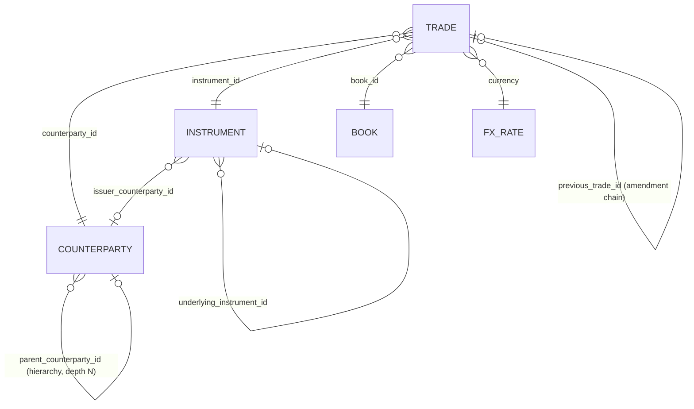
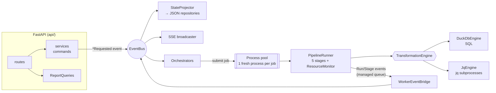

# DuckDB vs jq — trade transformation POC

An event-driven FastAPI service that takes **tabular trade data (CSV / Parquet)**, cleans and
validates it, resolves the **cross-references, backward references and deep hierarchies**
between its entities, and maps it to a **nested JSON** schema. It does all of that twice,
once with **DuckDB** and once with **jq**, then proves the two outputs are equivalent and
reports how long each stage took, how much memory it used, and how many cores it kept busy.

**Full illustrated report:** [docs/benchmark-report.html](docs/benchmark-report.html), with every benchmark explained in plain language, charts, service and dataflow diagrams, DuckDB memory fixes and alternatives. Open it in a browser.

## Results at a glance

Apple Silicon, 10 cores, 16 GB · Parquet source · default dirt (2%) · every run verified equivalent.
Reproduce with `make benchmark` (reports land in `data/reports/`).

| Trades | DuckDB | jq | jq ÷ DuckDB | DuckDB peak RSS | jq peak RSS | DuckDB rows/s | jq rows/s |
|---:|---:|---:|---:|---:|---:|---:|---:|
| 5,000 | 0.23 s | 1.7 s | 7× | 165 MB | 102 MB | 22k | 3.0k |
| 50,000 | 0.88 s | 15.0 s | 17× | 362 MB | 129 MB | 57k | 3.3k |
| 500,000 | 3.7 s | 2 min 30 s | 40× | 1.8 GB | 359 MB | 134k | 3.3k |
| 1,000,000 | 11.0 s | 5 min 14 s | 29× | 2.6 GB | 632 MB | 91k | 3.2k |
| 1,000,000, DuckDB on **1 thread** | 15.6 s | — | 20× | 1.9 GB | — | 64k | — |

Per stage at 1M rows (seconds):

| | ingest | clean | validate | transform | aggregate |
|---|---:|---:|---:|---:|---:|
| DuckDB | 0.56 | 0.60 | 0.21 | 8.93 | 0.66 |
| jq | 4.76 | 90.94 | 59.64 | 111.11 | 47.50 |
| jq ÷ DuckDB | 8× | 152× | 284× | 12× | 72× |

The 5M dataset is generated and saved (`trades-5m-s42-d20-h7-c5`, 76 MB Parquet / 553 MB CSV)
but was not run on the reference machine: each engine writes about 1.2 GB of trade JSON per
million rows, so a 5M comparison needs roughly 20 GB of free disk, which that machine did not
have. jq's throughput was flat at about 3.2k rows/s from 50k to 1M, which projects to about
26 minutes at 5M; DuckDB projects to about one minute. These are projections, not measurements.

---

## Quick start

Requirements: Python ≥ 3.12, [uv](https://docs.astral.sh/uv/), `jq` ≥ 1.7 on `PATH`.

```bash
make install          # uv sync
make test             # 34 tests: engine parity, edge cases, generator, API end-to-end
make run              # API + live dashboard on http://127.0.0.1:8000  (OpenAPI at /docs)
make datasets         # generate 5k / 50k / 500k / 1M / 5M (seed 42, reproducible)
make benchmark        # 5k..1M, both engines, verified, as a markdown table
```

Everything the dashboard does is plain HTTP, so the same flow from a terminal is:

```bash
curl -X POST localhost:8000/api/datasets/generate -H 'content-type: application/json' -d '{"rows": 50000}'
curl -X POST localhost:8000/api/comparisons      -H 'content-type: application/json' \
     -d '{"dataset_id": "trades-50k-s42-d20-h7-c5", "engines": ["duckdb", "jq"]}'
curl localhost:8000/api/comparisons/<comparison_id>          # timings, slowdown, verification
curl -N localhost:8000/api/events                            # live event stream (SSE)
curl -O localhost:8000/api/runs/<run_id>/outputs/trades/download   # every output row
```

---

## The data

`POST /api/datasets/generate` builds five related tables with numpy, deterministically: the
same parameters always produce the same dataset id and the same bytes, so any run can be
replayed. Files are written as Parquet and CSV under `data/datasets/<id>/` next to a
`manifest.json`. You can also upload your own files (`POST /api/datasets/upload`); only
`trades` is required.



| Size preset | trades | counterparties | instruments | Parquet | CSV |
|---|---:|---:|---:|---:|---:|
| 5k | 5,000 | 101 | 50 | 0.1 MB | 0.6 MB |
| 1M | 1,000,000 | 20,200 | 10,000 | 15 MB | 112 MB |
| 5M | 5,000,000 | 50,500 | 20,000 | 76 MB | 553 MB |

**Challenges built into the data** (controlled by `dirty_rate`, `hierarchy_depth`, `max_chain_length`):

| Challenge | What the generator does |
|---|---|
| Backward references | Amendments/cancels point to the previous version of the trade (`previous_trade_id`) |
| Forward references | Some originals are booked *after* their amendment, so the reference points ahead in the file |
| Deep nesting | Counterparty parent chains up to `hierarchy_depth` levels (default 7, try 200) |
| Cycles | Pairs of counterparties that are each other's parent; their subsidiaries inherit the problem |
| Broken references | Unknown counterparty / instrument / book / previous trade ids |
| Duplicates | Exact duplicate rows placed shortly after the original |
| Missing values | Missing currency (imputable from the instrument), settlement date (imputable as T+2), side |
| Type / format issues | `"1,250"`, `"N/A"`, negative prices, `DD/MM/YYYY`, `2025-02-30`, `" buy "`, `"usd"` |
| Raw landing schema | Every column is text in both formats, so dirt survives ingestion like a real landing zone |

---

## The pipeline (identical semantics in both engines)

| Stage | What happens |
|---|---|
| **ingest** | Read the five sources into the all-text landing schema |
| **clean** | Trim, upper-case codes, parse numbers and dates (strictly), normalise `side`, de-duplicate on `trade_id` (first wins), impute currency from the instrument and settlement as T+2 |
| **validate** | 13 rules in a fixed order (`app/domain/contract.py`). Any error rejects the trade into `rejects.ndjson`; warnings stay on the trade. Produces the quality report |
| **transform** | Resolve the counterparty hierarchy (ultimate parent, path, recursive `parent` object, cycle detection), instrument issuer and underlying, FX, and amendment lineage in both directions; then filter (`trade_date` range, instrument types, min notional, latest only) and shape the nested document |
| **aggregate** | Live exposure (latest, non-cancelled) per ultimate parent, with nested by-currency and by-subsidiary breakdowns |

One output document (`trades.ndjson`, one per line):

```json
{
  "trade_id": "TR0000000074", "event_type": "CANCEL", "trade_date": "2025-01-02", "settlement_date": "2025-01-04", "side": "SELL",
  "economics": {"quantity": 46651, "price": 23.2474, "currency": "GBP", "notional": 1084514.46, "fx_rate_to_usd": 1.2711, "notional_usd": 1378526.33},
  "instrument": {"instrument_id": "IN000018", "instrument_type": "EQUITY", "issuer": {"counterparty_id": "CP0000097", "...": "..."}, "underlying": null, "...": "..."},
  "counterparty": {
    "counterparty_id": "CP0000060", "legal_name": "Crescent Capital 0000060", "...": "...",
    "ultimate_parent": {"counterparty_id": "CP0000057", "legal_name": "Atlas Investments 0000057"},
    "hierarchy_depth": 1, "hierarchy_path": ["CP0000057", "CP0000060"],
    "parent": {"counterparty_id": "CP0000057", "legal_name": "Atlas Investments 0000057", "country": "GB", "parent": null}
  },
  "book": {"book_id": "BK0014", "desk": "Equities", "trader": "A. Rahimi", "region": "AMER"},
  "lineage": {"root_trade_id": "TR0000000007", "version": 3, "chain": ["TR0000000007", "TR0000000043", "TR0000000074"],
              "previous_trade_id": "TR0000000043", "superseded_by": null, "is_latest": true},
  "data_quality": {"warnings": []}
}
```

### How each engine does it

**DuckDB** keeps everything in in-memory columnar tables between stages and writes only the
final outputs. Logic lives in readable SQL: [`app/engines/duckdb_engine/sql/`](app/engines/duckdb_engine/sql/).

**jq** is a stream processor: a record in, records out. Anything that needs the whole dataset
(de-duplication, "does this id exist?", forward references, grouping) has to hold state in
memory, and anything that needs two views of the data needs two passes. Programs:
[`app/engines/jq_engine/programs/`](app/engines/jq_engine/programs/).

| Stage | jq passes | Memory held by jq |
|---|---|---|
| ingest | DuckDB `COPY` → NDJSON (jq cannot read CSV or Parquet) | — |
| clean | 4 reference entities + 1 streaming trade pass (`foreach` de-dup) | every `trade_id` seen so far |
| validate | ① build the trade-id set ② validate (streaming) ③ rejects ④ quality counts | the full trade-id set, all reference tables |
| transform | ① dimensions (hierarchy, nesting) ② lineage index ③ shape (streaming) | dimensions + amendment links |
| aggregate | 1 streaming `reduce` | one entry per group |

---

## Row tracking

After every run, a tracker reconciles each raw input row with the run's outputs and writes
`row_status.parquet`: one record per source row with its final state (`delivered`, `rejected`,
`duplicate`, `filtered_out`), the stage that removed it, rule violations and warnings, its
version, whether it counts toward exposure, and the byte offset of its output document.
The tracker reads only the source file and the outputs, so it is identical for both engines and
runs outside the five timed stages (about 0.3 s for 50k rows). Turn it off with
`POC_ENGINE__TRACK_ROWS=false`.

Open **http://127.0.0.1:8000/tracker** for the Trade tracker: pick a run, see where every row
ended up (funnel), search by trade id or row number, filter by state, and open a row to see its
journey (queued → each stage → finished, with real timestamps), the reasons in plain words, and
its record before and after with changed fields highlighted. The page updates live and its URL
(`#run=…&row=…`) can be shared.

| Endpoint | Purpose |
|---|---|
| `GET /api/runs` | Recent runs, with their row-tracking summary |
| `GET /api/runs/{id}/rows?state=&q=&limit=&offset=` | One page of row statuses |
| `GET /api/runs/{id}/rows/{source_row}` | One row: timeline, source record, output document or reject record |

## Architecture



```
app/
├── domain/          models, events, ports (Protocols), data contract — no I/O, no frameworks
├── application/     use cases: services (commands), orchestrators (event handlers), projections,
│                    pipeline runner, verification, reporting / queries
├── engines/         the two strategies: duckdb_engine/ (SQL) and jq_engine/ (jq programs)
├── infrastructure/  generator, process pool + event bridge, JSON repositories, resource monitor, SSE
├── api/             FastAPI routers, request schemas, static dashboard
├── bootstrap.py     composition root: the only place that knows every concrete class
├── cli.py           headless generate / benchmark using the same container
└── main.py          FastAPI app factory
```

| Pattern | Where | Why |
|---|---|---|
| Strategy | `TransformationEngine` → `DuckDbEngine`, `JqEngine` | Same stages, swappable implementation |
| Template Method | `PipelineRunner` | Fixed stage order + measurement; engines only fill in stages |
| Factory / registry | `app/engines/__init__.py` | Adding an engine = one class + one line |
| Event-driven, pub/sub | `EventBus`, `*Requested` → orchestrators | API returns `202` at once; work and progress are events |
| CQRS-lite projection | `StateProjector` | The only writer of persisted state; queries are read models |
| Ports & adapters / DI | `domain/ports.py`, `bootstrap.py` | Application code never imports infrastructure |
| Repository | `JsonFileRepository` | State survives restarts; dataset folders stay self-describing |

**Event flow of one comparison:** `ComparisonRequested → ComparisonStarted → (per engine)
RunStarted → StageStarted/StageCompleted ×5 → RunFinished → VerificationStarted →
ComparisonCompleted`. Watch it live on `/api/events` or in the dashboard's event panel.

**Scalability and concurrency.** CPU-bound work runs in a `ProcessPoolExecutor`
(`POC_MAX_WORKERS`, default 2), so several datasets and comparisons process in parallel while
the API stays responsive. Each job gets a fresh process (`max_tasks_per_child=1`). If a worker
is killed (for example by the OS for memory), the pool rebuilds itself and the run is marked
failed. Benchmarks run sizes strictly one at a time so their numbers are not distorted.

---

## How the comparison is kept fair

* **Same contract, proven equivalent.** After every comparison a verification job matches the
  outputs by key (`trade_id`, `ultimate_parent_id`), compares documents semantically (cent
  tolerance for floats summed in a different order), checks row counts and a digest of every
  key, and compares the quality reports. Above 200k rows it deep-compares a deterministic
  hash sample of about 50k documents. The rule codes in the SQL and in the jq programs are
  checked against the contract by a test.
* **Same measurement.** Every stage is wrapped by the same `ResourceMonitor`: wall time, CPU
  seconds (`getrusage`, including reaped jq children), and peak RSS of the whole process tree
  (sampled every 50 ms). "Cores" is CPU-seconds ÷ wall-seconds.
* **jq is written idiomatically and tuned.** Streaming wherever possible (`inputs`,
  `foreach`, `reduce`), with no `--slurp` of the trade stream, and intermediates deleted as
  soon as they're no longer needed. The aggregate pass was optimised from measurement
  (see below).
* **jq's CSV/Parquet adapter is DuckDB.** That's the fastest conversion available, so it
  favours jq; it is still counted in jq's ingest stage because jq can't read those formats.

---

## API

| Method & path | Purpose |
|---|---|
| `POST /api/datasets/generate` | Generate one synthetic dataset (`rows`, `seed`, `dirty_rate`, `hierarchy_depth`, `max_chain_length`, `formats`) |
| `POST /api/datasets/presets` | Generate 5k / 50k / 500k / 1M / 5M |
| `POST /api/datasets/upload` | Multipart upload: `trades` (required), `counterparties`, `instruments`, `books`, `fx_rates` |
| `GET /api/datasets[/{id}]` | Manifests: status, row counts, sizes, generation time |
| `POST /api/comparisons` | Run the pipeline on chosen engines (`engines`, `source_format`, `params` filters, `verify`, `parallel_engines`) |
| `GET /api/comparisons[/{id}]` | Per-engine, per-stage timings, slowdown vs DuckDB, verification |
| `GET /api/runs/{id}` | One engine's run with stage metrics and quality report |
| `GET /api/runs/{id}/outputs/{trades\|rejects\|exposures\|quality_report}` | Paged preview (`offset`, `limit`) |
| `GET /api/runs/{id}/outputs/{name}/download` | The complete output file (all rows) |
| `POST /api/benchmarks` · `GET /api/benchmarks/{id}[/report.md]` | Suites across sizes, as JSON or a markdown table |
| `GET /api/events` | Server-Sent Events: every domain event, live |

## Configuration

Environment variables (`app/config.py`):

| Variable | Default | |
|---|---|---|
| `POC_DATA_DIR` | `data` | Datasets, run outputs, state, reports |
| `POC_MAX_WORKERS` | `2` | Parallel jobs (generation, runs, verification) |
| `POC_ENGINE__DUCKDB_THREADS` | all cores | Pin to `1` for a single-core comparison with jq |
| `POC_ENGINE__DUCKDB_MEMORY_LIMIT` | `8GB` | DuckDB spills to disk beyond this |
| `POC_ENGINE__DUCKDB_LEAN` | `false` | Stream the trade JSON from a view and drop tables early (≈60% less memory) |
| `POC_ENGINE__DUCKDB_PRESERVE_INSERTION_ORDER` | `true` | `false` = faster, leaner; output rows in any order |
| `POC_ENGINE__DUCKDB_STORAGE` | `memory` | `disk` keeps tables in a database file in the run's work dir |
| `POC_ENGINE__JQ_MAX_RSS_MB` | `12000` | Watchdog: jq is killed above this and the run fails with a clear message |
| `POC_ENGINE__JQ_TIMEOUT_SECONDS` | `3600` | Per jq pass |
| `POC_ENGINE__TRACK_ROWS` | `true` | Build the per-row status table after each run |
| `POC_ENGINE__KEEP_INTERMEDIATES` | `false` | Keep jq's NDJSON intermediates for inspection |

---

## Findings

**1. DuckDB is 7–40× faster end to end, and up to 280× faster on individual stages.** jq's
throughput is flat (≈3.3k rows/s at every size: one core, linear work), while DuckDB's rises
with size until JSON output dominates.

**2. It isn't just the extra cores.** Pinned to one thread, DuckDB still does 1M rows in
15.6 s, about 20× faster than jq. The gap comes from vectorised, columnar execution, and from
not having to re-parse and re-serialise JSON between passes. A jq pass that only parses the 1M-row
output (1.2 GB) and counts it already takes 18 s.

**3. Where DuckDB's time goes is writing JSON.** At 1M rows, 8.9 s of its 11 s is the
transform stage, almost all of it serialising 1.2 GB of nested documents. Cleaning and
validating a million rows takes under a second. The row-to-JSON conversion is the cost
both engines share.

**4. jq used less memory in these runs** (632 MB vs 2.6 GB at 1M), because it streams and
DuckDB keeps whole tables in memory. But jq's memory grows with the number of distinct keys
(the de-duplication "seen" set and the trade-id set for reference checks), and jq can't
spill to disk. DuckDB is capped by `memory_limit` and spills beyond it. The worker's
watchdog (`POC_ENGINE__JQ_MAX_RSS_MB`) kills jq cleanly before it can take the machine down.

**5. DuckDB's memory can be cut without losing speed.** The peak comes from materialising the
full nested result table before writing JSON. At 1M rows (DuckDB only, 12 runs in one session):

| Setting | Peak memory | Time |
|---|---:|---:|
| Default | 3.2 GB | 6.3 s |
| Lean (stream from a view, drop tables early) | 1.4 GB | 7.9 s |
| **Lean + `preserve_insertion_order=false`** | **1.4 GB** | **3.2 s** |
| Lean + unordered + 512 MB limit + on-disk database | 752 MB | 7.9 s |
| 1 GB memory limit only | fails (out of memory) | — |
| On-disk database only | 3.4 GB | 13.7 s |

A memory limit only works together with lean mode, and spilling needs free disk. Unordered
output changes row order, and "first duplicate wins" then follows read order for non-identical
duplicates.

### Where jq struggles

| Challenge | What happens in jq |
|---|---|
| Reading the source | No CSV/Parquet reader. Something else has to convert first (DuckDB does it here, timed in jq's ingest) |
| Backward / forward references | A single streaming pass can't check a reference to a row it hasn't seen. Validation needs a separate pass to build the id set; lineage needs a full-stream index |
| Multiple views of the data | Each extra view is another process re-parsing the whole NDJSON stream: 4 passes to validate, 3 to transform |
| Single-threaded | Only per-record stages could be sharded across processes; de-duplication, reference checks and grouping can't, without a merge step |
| Formulation sensitivity | Measured on 100k real documents: `.[$k] \|= f` is ~1.6× slower than direct paths; flat composite keys are ~20× slower; projecting before `reduce` is 2.6–4.5× faster. The aggregate stage went from 188 s to 47.5 s at 1M from these rewrites alone |
| Dates and numbers | `strptime` silently rolls `2025-02-30` over to `03-02`, so strict parsing needs a format round-trip. Numbers are IEEE doubles only (no decimal type) |

### Where DuckDB struggles

| Challenge | What happens in DuckDB |
|---|---|
| Unbounded recursive nesting | No recursive `STRUCT` type, so `parent → parent → …` to arbitrary depth can't be a typed struct. Workaround: build that column as `JSON` top-down in a recursive CTE, so each node wraps its parent's already-built JSON. It works, but the column loses typing |
| Cycles | A naive recursive CTE that walks up from each node loops forever on `A → B → A`. Walking down from the roots ends by construction and leaves cycle members unresolved, which is how they get flagged. jq needs an explicit "seen" set for the same thing |
| Memory | Several times jq's peak RSS at these sizes; needs a sensible `memory_limit` |
| Per-record, procedural logic | Ordered rule lists, conditional imputation with warnings and per-row lists are more verbose in SQL (`list_filter([CASE …])`) than in jq |

### Stress scenarios (50k trades, `make scenarios`)

| Scenario | DuckDB transform | jq transform | DuckDB total | jq total |
|---|---:|---:|---:|---:|
| Baseline (depth 7, chains ≤ 5) | 0.56 s | 5.2 s | 0.88 s | 15.0 s |
| Counterparty hierarchy **200 levels deep** | 1.59 s (2.8×) | 12.1 s (2.3×) | 1.90 s | 23.4 s |
| Amendment chains **up to 100 long** | 1.07 s (1.9×) | 11.0 s (2.1×) | 1.38 s | 20.0 s |

Deep nesting and long back-reference chains slow both engines by a similar factor (the output
documents themselves get bigger: an O(depth) nested object and an O(length) chain per trade).
Neither engine breaks. The difference is in how naturally each one expresses the work, not
in how it scales. A 500k run from **CSV** instead of Parquet changed DuckDB's ingest from
0.28 s to 0.36 s and jq's by under a second; source format is not what matters here.

### Recommendation

For a transformation service like this (joins, de-duplication, reference resolution,
aggregation, millions of rows), **use DuckDB as the engine.** It's an order of magnitude
faster, it uses all cores, it spills instead of failing, and it reads CSV and Parquet natively.
jq is still useful at the edges: ad-hoc inspection and reshaping of the JSON DuckDB produces,
or small per-document tweaks where its brevity wins and the data fits a single stream.

### Limitations and next steps

* The event bus and job queue are in-process: one API process with a process pool. To scale
  past one machine, swap `EventBus`/`ProcessJobExecutor` for a broker (Redis Streams, Kafka,
  SQS) behind the same ports; the application layer stays as it is.
* Outputs are uncompressed NDJSON, to keep the comparison simple. DuckDB can write
  compressed JSON or Parquet directly; for jq that means piping through a compressor.
* Benchmarks are single runs. For publication, repeat each size and report the median.
* No authentication or upload size limits; this is a local POC.
